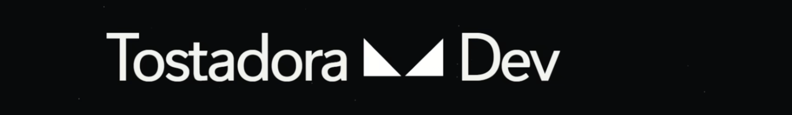

</a>
<h1 align="center">Hello 👋, this is ToastDev on the beat! 🎵🔥</h1>

---

  
  
  
  
  
  
  

  <code>Mechatronics student who codes, lol.</code>

<h3 align="center">
  </img> 
  I'm a teenager who wants to create unusual things using computers
</h3>

  When I was 10 years old, I wrote my first "Hello, World!" program. A few years ago, I also built a traffic light system using Arduino. These experiences sparked my interest in science and engineering, and I've considered studying fields such as informatics, pharmaceutical chemistry, computer science, and mechatronics (my current goal). I want to create weird but useful projects that everyone can enjoy and use. :)

<h1 align="center"></img> Projects</h2>
<table align="center">
  <tr>
    <th align="center">YASLA</th>
    <th align="center">KillerBot</th>
    <th align="center">StormReach</th>
    <th align="center">Clairune</th>
  </tr>
   <!-- <tr>
    <td align="center">
      
    </td>
    <td align="center">
      
    </td>
    <td align="center">
      
    </td>
    <td align="center">
      
    </td>
  </tr> -->
  <tr>
    <td align="center">
     An open-source Android application for rendering TTML and AMLL (Apple Music) lyrics, featuring widgets and an overlay
    </td>
    <td align="center">
     A multi-purpose Discord bot written in Node.js to combat boredom and malicious users
    </td>
    <td align="center">
      A fantasy RPG set in a dystopian city, featuring a curse that grants you stellar powers
    </td>
    <td align="center">
      A modular AI assistant designed to bring language models, memory, tools, and automation together
    </td>
  </tr>
  <tr>
    <td align="center">
      <code>Kotlin</code>
    </td>
    <td align="center">
      <code>JavaScript</code>
    </td>
    <td align="center">
      <code>Luau</code>
    </td>
    <td align="center">
      <code>HTML/Css/JavaScript/Python</code>
    </td>
  </tr>
  <tr>
    <td align="center">
      <!-- <a href="https://github.com/USERNAME/YASLA"> -->
        View Project
      </a>
    </td>
    <td align="center">
      <!-- <a href="https://github.com/USERNAME/KillerBot"> -->
        View Project
      </a>
    </td>
    <td align="center">
      <!-- <a href="https://github.com/USERNAME/StormReach"> -->
        View Project
      </a>
    </td>
    <td align="center">
      <!-- <a href="https://github.com/USERNAME/Clairune"> -->
        View Project
      </a>
    </td>
  </tr>
</table>

<h1 align="center"></img> Favorite songs/albums</h2>

<!-- MUSIC-GALLERY:START -->
<table align="center">
  <tr>
    <td align="center" valign="top" width="175">
       
      <strong>DATA</strong> 
      Tainy
    </td>
    <td align="center" valign="top" width="175">
       
      <strong>Primera Musa</strong> 
      Omar Courtz
    </td>
    <td align="center" valign="top" width="175">
       
      <strong>nadie sabe lo que va a pasar mañana</strong> 
      Bad Bunny
    </td>
    <td align="center" valign="top" width="175">
       
      <strong>$AD BOYZ 4 LIFE II</strong> 
      Junior H
    </td>
  </tr>
  <tr>
    <td align="center" valign="top" width="175">
       
      <strong>Short n&#x27; Sweet</strong> 
      Sabrina Carpenter
    </td>
    <td align="center" valign="top" width="175">
       
      <strong>PRISM</strong> 
      Katy Perry
    </td>
    <td align="center" valign="top" width="175">
       
      <strong>YHLQMDLG</strong> 
      Bad Bunny
    </td>
    <td align="center" valign="top" width="175">
       
      <strong>DAMN.</strong> 
      Kendrick Lamar
    </td>
  </tr>
</table>
<!-- MUSIC-GALLERY:END -->

[Project Link](https://github.com/TostadoraDev/coverflow "Check out Coverflow!") :)
